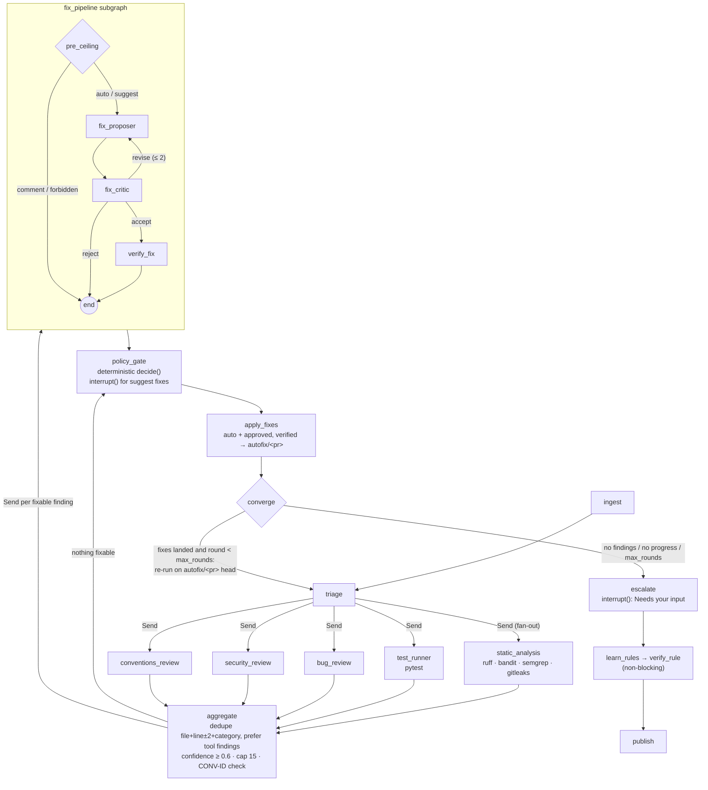
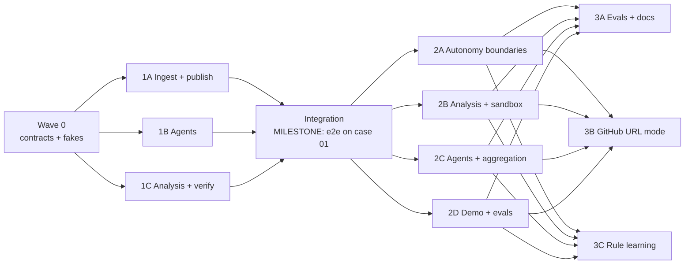

# PR Review & Autofix Agent: Implementation Plan (MVP)

> Companion documents: [AGENTS.md](AGENTS.md) (every agent's role, inputs, outputs, limits and eval metric) and [DESIGN.md](DESIGN.md) describes the production architecture this MVP is cut from, and its §9 "Production path" is the roadmap.

## Planning approach

The plan started from a production-scale design: GitHub App, webhooks, queue-backed workers, Postgres checkpoints and a k8s sandbox pool. That design was then scoped down to an MVP that runs end-to-end on a laptop with two API keys and one command, without giving up the parts that matter: real static analyzers, real sandboxed test runs, and a LangGraph workflow with fan-out, a revise loop and a human approval gate. **Autonomy boundaries** were made a first-class requirement. They are deterministic, read from the PR's base branch, and enforced in code rather than in prompts, so a PR cannot grant itself autonomy. The workflow is a **convergence loop**: fixes that land are re-analyzed and re-tested, and anything still open at the end is escalated to a person, never silently dropped. **Rule learning** was then added on top: every verified finding becomes a candidate lint rule or convention, so the same class of mistake is caught upfront next time. The work is split into short waves of 3–4 independent streams, and each wave ends with a commit and a summary of what was built and tested.

---

## 1. Context

The agent improves pull requests: it reviews, fixes, and re-verifies in loops until every finding is resolved. When it can't resolve something safely, it stops and escalates: it asks the author a question or requests a human review.

The MVP runs end-to-end locally with **2 API keys** (`ANTHROPIC_API_KEY`, `LANGSMITH_API_KEY`) and **one command**. The code stays small and readable (target ≈ 2–2.5k LOC of `src/`).

**Quick start (≤ 3 commands):**

```bash
git clone <repo> && cd <repo>
cp .env.example .env        # paste the 2 keys
uv run pr-agent demo        # builds demo repo, reviews seeded PR #1, prints review + LangSmith link
```

`uv run pr-agent eval` runs all 12 seeded cases through LangSmith `evaluate()`.

## 2. Risks and constraints addressed

1. **"2 API keys" vs GitHub URL mode.** Public PRs work without a token (60 req/h). Private PRs need `GITHUB_TOKEN` (read-only). The one-command demo therefore uses `--local` against the bundled demo repo, so it needs no GitHub at all.
2. **The Docker fallback runs PR code unsandboxed.** In temp-dir mode, static tools still run because they don't execute code. **pytest only runs unsandboxed in `--local` mode**, where the code is your own. In GitHub URL mode without Docker, pytest is skipped and the review says so in a banner.
3. **The head branch could sabotage the reviewer's own config**, not only `.pr-agent.yml`. So everything the repo supplies is read from the **base** sha: `.pr-agent.yml`, `CONVENTIONS.md`, the `.semgrep/` custom rules and the ruff config. Otherwise a PR could inject conventions or disable rules.
4. **`semgrep --config auto` needs network**, which breaks with `--network none`. Semgrep runs offline instead, with vendored rules (`src/pr_agent/analyzers/semgrep_rules/`) plus the base branch's `.semgrep/`. The `custom:NAMING-* / ERR-* / SEC-*` lint IDs come from those semgrep rules.
5. **LLM evals are noisy.** We use temperature 0 and one run per case, and report the numbers as measured. The deterministic policy behaviour (cases 9–12) is **also** covered by offline unit tests that need no API key, so those guarantees don't depend on LLM output.
6. **Fix ordering.** `verify_fix` runs before `policy_gate`. To avoid paying for patches that can never ship, a **pre-ceiling check** skips the fixer when the finding's location is already `comment`/`forbidden`. `policy_gate` stays the only authority and re-checks the *actual* patch.

## 3. Key implementation decisions

| Area | Decision |
|---|---|
| Triage | **Deterministic** (no LLM). Classifies files (py/test/docs/config), drops generated/binary/lock files, skips LLM reviewers for docs-only PRs, caps diff size |
| Lint fixes | **Deterministic** via `ruff check --fix --select <rule>` / `ruff format`. The LLM fixer is only used for bug/security/convention findings |
| `fix_type` | Derived from the finding's **source**, never chosen by the LLM: ruff format→`format`; ruff and custom semgrep→`lint`; bandit, semgrep security rules, gitleaks and the security reviewer→`security`; the bug reviewer and pytest→`bug`; conventions→`lint` with rule id `conv:CONV-xxx`. A `format` fix must produce an identical AST, or it is reclassified as `bug` |
| Unlisted lint rule | → `suggest` |
| Conventions findings | Must cite a CONV-ID that exists in the base `CONVENTIONS.md`. Otherwise they are **dropped in aggregate** by a deterministic check |
| Path globbing | `pathspec` (gitwildmatch). When several rules match, the most restrictive wins and owners are unioned |
| Fail-closed | A missing or invalid config caps everything at `suggest`. Hard rules still apply, and a review banner shows the validation error |
| Models | `claude-sonnet-5-5` for reviewers and `claude-opus-5-5` for the fixer and critic, overridable via env. Uses `with_structured_output(Pydantic)` |
| Reviewer context | Diff plus the full content of changed files (truncated), and no tools. PR title, description and diff are wrapped in `<untrusted_pr_content>`. The LLM has no write capability anywhere |
| `interrupt()` UX | Interactive TTY: lists the `suggest` fixes and asks which to apply. Non-interactive/eval: resumes with nothing approved. `pr-agent resume <run-id> --approve F2,F3` approves later, as the `/autofix apply` equivalent. State lives in `SqliteSaver` at `.pr-agent/checkpoints.sqlite` |
| autofix branch | Created via a temporary `git worktree`. It never checks out, never touches the working tree and never pushes. Auto fixes plus approved fixes are applied sequentially and re-verified once combined; a conflicting fix is dropped with a reason |
| Sandbox image | `python:3.12-slim` plus pinned ruff, bandit, semgrep, pytest and gitleaks, built on first run. The demo tests import pure logic modules, so the sandbox doesn't need FastAPI |
| gitleaks without Docker | If the binary is missing, the analyzer reports `skipped` in the review. Case 2 is still covered by bandit B105 and the security reviewer |
| Demo repo | `demo/base/` snapshot plus `demo/cases/NN_slug/{pr.json, expected.json, offline.json, files/}`. `files/` overlays the changed files: full file contents are more reliable than hand-written diffs. `offline.json` holds scripted LLM outputs, so the whole pipeline runs without an API key (`pr-agent eval --offline`). `demo/build.py` creates a throwaway git repo at `.pr-agent/demo-repo/` with `main` and one branch per case, so there are no nested git repos. The demo base ruff config enables only `E,F,I,B,UP`, so rule learning has real not-yet-enabled rules (e.g. `S608`) to find |
| Case 02 secret | **No secret-looking literal is ever committed.** `cases/02_*/files/src/store/notify.py.tmpl` holds placeholders. `build.py` derives the values at build time (e.g. `hashlib.sha256(b"pr-agent-demo-02").hexdigest()[:32]`, joined from split strings) and renders `DB_PASSWORD = "<hex>"` / `api_key = "<hex>"`: a generic pattern caught by bandit B105 and gitleaks `generic-api-key`, with no provider formats (no `AKIA…`/`ghp_…`/`sk-…`). The redaction unit tests generate their fixtures the same way |
| Outputs / ignores | All run output goes under `./.pr-agent/` (runs, checkpoints, demo repo). `.gitignore` lists `.pr-agent/` (a directory-only pattern, so `.pr-agent.yml` is unaffected), `.env`, `.venv/`, `__pycache__/` and `.pytest_cache/` |

## 4. Autonomy boundaries (critical requirement)

- `templates/.pr-agent.yml` is shipped **byte-for-byte** in the format specified (see §9). `pr-agent init [path]` copies it into a repo and refuses to overwrite without `--force`. `pr-agent check-config [path]` validates it with Pydantic (`extra="forbid"`, `version == 1`) and prints errors.
- **Loader:** `git show <base_sha>:.pr-agent.yml`, never the head.
- **`policy/engine.py: decide(fix, ctx, cfg) -> PolicyDecision(level, decided_by, reason, owners)`** is pure, deterministic and unit-tested. The effective level is the **most restrictive** (`auto < suggest < comment < forbidden`) of:
  1. **Every touched path** in the patch (`paths[]`, else `default_sensitivity`), mapped via `levels`.
  2. **Every touched route.** `policy/routes.py` uses `ast` to find FastAPI handlers (`@app/@router.<method>(...)`, literal `APIRouter(prefix=)`) and Flask handlers (`@app.route(..., methods=)`). Patch lines inside a handler body map to `METHOD /path`, which is matched against `routes[]` with `{param}` treated as one segment. A matched route with no rule, or a non-literal path, gets `default_sensitivity`.
  3. **The fix type** cap (`fix_types`). `policy/api_diff.py` does an AST signature diff of public (non-`_`) functions, classes and methods before vs after the patch. Any change means `public_api_change`.
  4. **The lint rule** cap (`lint_rules`, glob on `tool:RULE`).
  5. **Limits:** `auto` with more than `auto_max_lines` or `auto_max_files` becomes `suggest`.
  6. **Hard rules** (`policy/hard_rules.py`, not configurable) make it `forbidden`. They cover:
     - editing `.pr-agent.yml`, `CONVENTIONS.md`, lint configs (`ruff.toml`, `.ruff.toml`, `[tool.ruff]` or any change in `pyproject.toml`, `setup.cfg`, `.semgrep/**`), `CODEOWNERS` or CI (`.github/**`);
     - deleting or skipping tests (removed `test_*` defs/files, added `pytest.mark.skip`/`skipif`/`xfail`/`pytest.skip(`);
     - adding or upgrading dependencies (`pyproject` deps, `requirements*.txt`, `uv.lock`, `poetry.lock`);
     - paths escaping the repo;
     - adding a scanner suppression (`# nosec`, `# noqa`, `# nosemgrep`, `gitleaks:allow`, `# type: ignore`);
     - editing `.gitattributes`, `.gitleaks.toml`, `.gitleaksignore` or `conftest.py`.
- Every decision carries `decided_by` (e.g. `paths[0] "src/payments/**" -> critical`, `hard_rule:no_test_skip`). It appears in the review comment **and** in LangSmith metadata (`policy_decisions`, plus the tags `policy:blocked` / `policy:downgraded`).
- The fixer receives the boundaries as **context only**. Nothing in a prompt is enforcement.
- A PR that edits `.pr-agent.yml` gets an informational finding: "autonomy config change takes effect only after merge; base config applied".

## 5. Graph (LangGraph)



- **verify_fix:** fresh copy of head → `git apply --check` → apply → re-run the originating analyzer (the finding must be gone) → ruff + bandit on the touched files (no new findings) → pytest (full suite in the MVP). On failure the fix is downgraded to `comment` with the reason.
- **test_runner:** runs pytest on head. Failing tests are re-run on base to separate *introduced* failures from *pre-existing* ones.
- **publish:** writes the following, and `--post` (stretch, needs a write token) posts one PR review to GitHub:
  - `.pr-agent/runs/<run-id>/review.md`: summary, config status banner, sandbox mode, skipped tools, findings with file:line + rule/CONV-ID, fixes with level + `decided_by` + suggestion blocks, and owners tagged;
  - `patches/F<n>.patch`;
  - `review.json` (used by evals);
  - the branch `autofix/<pr>`.
- **Tracing:** `graph.invoke(config={"run_name": "review <repo>#<pr>", "tags": ["repo:…","pr:…","sha:…"], "metadata": {...}})`. A LangSmith `Client(hide_inputs=redact, hide_outputs=redact)` scrubs keys, tokens, private keys and high-entropy strings. The same `redact()` is applied to review.md, since case 2 seeds a real-looking secret.
- **Budget guard:** at most 8 findings go to the fixer per round, and LLM calls are capped per run (env-configurable).

### Convergence loop and escalation

- **Rounds.** After `policy_gate`, `apply_fixes` commits the verified `auto` and approved fixes onto `autofix/<pr>`. When anything landed, `converge` points the PR context at the new branch tip (same base sha) and loops back to `triage`. Analysis, tests and reviewers then run on the improved code, so they catch both what remains and anything a fix introduced, and the next round fixes those.
- **Per-round state.** Raw findings, fixes, verifications and approvals are reset each round with LangGraph `Overwrite`. A history entry `{round, head_sha, findings, applied}` is appended. Finding ids stay stable across rounds: the same file + rule/category + message keeps its `F<n>`.
- **Default:** on (`PR_AGENT_CONVERGE=1`). Set `PR_AGENT_CONVERGE=0` for a single round (no `escalate` node).
- **Deferral:** `verify_fix` lets a fix pass even if it introduces new lint, but only when another round exists and that lint is fixable by a deterministic ruff fix. Otherwise new findings fail verification.
- **Stable ids:** keyed on file + rule + the flagged line's source text. An id whose fix already landed is never handed to a different finding.
- **Stop conditions:** no findings remain; or a round makes no progress (nothing applied); or `max_rounds` is reached (default 3, `PR_AGENT_MAX_ROUNDS`).
- **Escalate, never drop.** Every finding still open at the end becomes an escalation with a reason and a record of what was tried:

  | Situation | Escalation |
  |---|---|
  | Blocked by policy (`forbidden`/`comment`, or `suggest` not approved) | **review request** to the owners (or the author), citing `decided_by` |
  | Ambiguous intent, or the critic rejected every attempt | **question to the author**: a concrete question built from the finding, the attempts and the critic's notes |
  | `verify_fix` kept failing | **review request** with the failure evidence (failed checks + log tail) |
  | Not auto-fixable by design (failing test, config change) | **review request** with the evidence |

- Escalations go through `interrupt()`. An interactive run can answer them, and the answers are recorded. They appear in review.md under **"Needs your input"**. `rounds` and `escalations` are recorded as LangSmith metadata.

### Rule learning

- **Input:** findings whose fix passed `verify_fix`. Fixed code is required for the "silent on fixed code" check, so findings skipped at pre-ceiling (critical/high paths) get no proposal. Findings already caught by a rule *enabled in the base config* are skipped, because they're already prevented.
- **learn_rules** walks a preference ladder and stops at the first option that applies:
  1. **Existing rule** (deterministic, no LLM): `ruff check --select ALL --output-format json` plus full bandit on the finding's file. It keeps hits within ±2 lines of the finding whose rule isn't enabled in the base ruff/bandit config. Proposal: "enable `ruff:S608`".
  2. **New semgrep rule** (drafted by the LLM, `agents/rule_drafter.py`): rule `custom:<AREA>-<n>` (AREA from the category, e.g. SEC/ERR/BUG; n = next free id in base `.semgrep/`), plus a test file with `# ruleid:` / `# ok:` lines built from the before/after code.
  3. **Convention** (drafted by the LLM): a `CONVENTIONS.md` entry with the next free CONV-ID, a rationale, and bad/good examples.
- **verify_rule** (deterministic, runs in the sandbox):
  - Semgrep rules: `semgrep --test` passes, the rule hits head at the finding (±2 lines), it doesn't hit that spot on head + the verified patch, and the base hit count N is computed. If N > 5, the proposal is flagged "would also flag N existing places".
  - Existing rules: the same fire/silent/base-count checks.
  - Conventions: the CONV-ID is unique and well-formed, both examples pass `ast.parse`, and bad ≠ good. Static firing doesn't apply here, so these are labelled "convention (not machine-checked)".
  - Any failure drops the proposal, and the reason is logged.
- **Output:** `.pr-agent/runs/<id>/rules/` (rule yml + test file / enable snippet / convention md + `proposals.json`) and a **"Prevent this next time"** section in review.md. `--rules-branch` optionally creates `rules/<pr>` via a temporary worktree. At most 3 proposals per run, recorded in LangSmith metadata as `rule_proposals`.
- **Critical/high paths:** no fix is attempted there, so there is no fixed code. Only step (a) runs (the rule must fire at the finding, and base hits are counted), and the proposal is labelled "partially verified (no fixed code)".
- **"Already prevented"** means enforced by the repo's *own* base config (ruff `select`, base `.semgrep/`). The agent's built-in bandit and vendored semgrep rules don't count.
- **Hard rules vs `rules/<pr>`:** the hard rules forbid the agent from editing `CONVENTIONS.md`, `.semgrep/` and lint configs. So the branch only **adds** files under `pr-agent-proposals/<pr>/`: new rule files, plus ready-to-apply `.patch` files for config/CONVENTIONS changes. A human applies them in their own PR. The hard-rule checker runs on that branch's diff too.

## 6. Repo layout

```text
pyproject.toml            # uv; entry point pr-agent = pr_agent.cli:app; testpaths=tests; ruff excludes demo/
.gitignore  .env.example  README.md  docs/DESIGN.md  docs/IMPLEMENTATION_PLAN.md  templates/.pr-agent.yml
src/pr_agent/
  cli.py                  # typer: review, resume, init, check-config, demo, eval
  settings.py             # env: models, thresholds, caps, sandbox mode
  models.py               # Finding, FixProposal, Verification, PolicyDecision, Level, PRContext
  state.py                # ReviewState TypedDict + reducers
  graph.py                # build_graph() + SqliteSaver; fix_pipeline subgraph
  tracing.py              # LangSmith client, redact(), run config/tags
  ingest/   local.py  github.py  diff.py          # git refs/sha, unidiff parsing, file filters
  sandbox.py              # Sandbox protocol, DockerSandbox (--network none, --cpus, --memory, --pids-limit, timeout), LocalSandbox
  sandbox.Dockerfile
  analyzers/ ruff.py bandit.py semgrep.py gitleaks.py pytest_runner.py semgrep_rules/
  agents/   llm.py  reviewers.py  fixer.py  critic.py  rule_drafter.py  prompts/*.md
  learning/ existing_rules.py  verify_rule.py      # rule learning: ladder step (a) + deterministic validation
  policy/   config.py  engine.py  routes.py  api_diff.py  hard_rules.py
  nodes/    ingest.py triage.py analyze.py review.py aggregate.py fix.py verify.py gate.py learn.py publish.py
  publish/  markdown.py  git_branch.py  github_post.py (stretch)
demo/  base/ (src/api, src/payments, src/auth, scripts, tests, CONVENTIONS.md, .pr-agent.yml, .semgrep/)  cases/01..12/  build.py
evals/ run.py  evaluators.py  results.md
tests/ unit/ (policy, config, routes, api_diff, hard_rules, aggregate, diff, sandbox)  test_graph_fake.py  fakes.py
```

## 7. Execution waves

At most 3–4 parallel streams per wave. Each wave ends with a git commit and a short summary of what was built and what is tested.



### Wave 0: contracts + fakes (1 stream, integration lead)

`git init`, `.gitignore`, `pyproject.toml`/uv, `models.py`, `state.py`, the `Sandbox` protocol + `LocalSandbox`, and `tests/fakes.py` (FakeLLM returning canned structured outputs, FakeSandbox). Also the `cli.py` skeleton, `templates/.pr-agent.yml` (exact), and `demo/base/` + case 01 (SQL injection) + `demo/build.py`.

*Tested:* model validation, the template is byte-identical, and the demo build creates the branch.

### Wave 1: walking skeleton

**Milestone:** one full end-to-end run on case 01 with one reviewer (3 streams, then integration).

| Stream | Scope | Files | Depends on |
|---|---|---|---|
| 1A Ingest + publish | local ingest, diff parsing, markdown review, patch files, autofix branch via worktree | `ingest/local.py`, `ingest/diff.py`, `publish/*`, `nodes/ingest.py`, `nodes/publish.py` | W0 |
| 1B Agents | security reviewer, fixer, critic (revise ≤2), untrusted wrapping, prompts | `agents/*`, `nodes/review.py`, `nodes/fix.py` | W0 |
| 1C Analysis + verify | bandit analyzer, verify_fix on LocalSandbox, minimal policy (path table + base-branch loader + fail-closed) | `analyzers/bandit.py`, `nodes/analyze.py`, `nodes/verify.py`, `policy/config.py`, `policy/engine.py` (paths only), `nodes/gate.py` | W0 |
| Integration (integration lead) | `graph.py` incl. Send + subgraph + interrupt, `tracing.py`, `pr-agent review --local` + `demo` | `graph.py`, `tracing.py`, `cli.py` | 1A, 1B, 1C |

*Done when:* `uv run pr-agent demo` produces review.md + a patch for case 01, and the trace is visible and tagged in LangSmith.

### Wave 2: breadth (4 parallel streams)

| Stream | Scope | Files | Depends on |
|---|---|---|---|
| 2A Autonomy boundaries | full schema, `init`/`check-config`, routes (AST), api_diff (AST), hard rules, limits, lint/fix-type caps, `decided_by`, LangSmith metadata, pre-ceiling; offline unit tests for cases 9–12 | `policy/*`, `nodes/gate.py`, `tests/unit/test_policy*.py` | W1 |
| 2B Analysis + sandbox | ruff (+ deterministic fixes), semgrep (offline rules), gitleaks, pytest runner (base/head classification), DockerSandbox + Dockerfile + fallback rules (§2.2) | `analyzers/*`, `sandbox.py`, `sandbox.Dockerfile`, `nodes/analyze.py`, `nodes/verify.py` | W1 |
| 2C Agents + aggregation | bug + conventions reviewers (CONV-ID), injection hardening, deterministic triage, aggregate dedupe/threshold/cap, `resume --approve` | `agents/*`, `nodes/triage.py`, `nodes/review.py`, `nodes/aggregate.py`, `cli.py` (resume) | W1 |
| 2D Demo + evals | seeded cases 02–12 with `expected.json` (case 02 rendered from a template at build time), LangSmith dataset sync, `evaluate()`; evaluators: precision, recall, fix_pass_rate, policy_correct, clean_zero, injection_unchanged; `results.md` generator | `demo/**`, `evals/*` | W1 (cases need 2A–2C to pass) |

**Ownership rule:** only the integration lead edits `models.py`, `state.py` and `graph.py`. A stream that needs a contract change asks for it rather than editing those files.

### Wave 3: polish, convergence loop, rule learning

| Stream | Scope | Files | Depends on |
|---|---|---|---|
| 3A Evals + docs | full eval run + threshold tuning, README (≤3-command setup, `.env.example`, Mermaid architecture diagram, eval results table), keep `docs/DESIGN.md` in sync with the code | `evals/*`, `README.md`, `docs/DESIGN.md` | W2 (+3C for the final table) |
| 3B GitHub URL mode | `ingest/github.py` (REST metadata, partial clone, `refs/pull/N/head`), `--post` stretch | `ingest/github.py`, `publish/github_post.py` | W2 |
| 3D Convergence loop (integration lead) | `apply_fixes`, `converge` (stop conditions, `Overwrite` resets, stable ids), `escalate` (interrupt + "Needs your input"), `rounds`/`escalations` metadata, eval case 13 | `graph.py`, `nodes/apply.py`, `nodes/converge.py`, `nodes/escalate.py`, `nodes/publish.py`, `runner.py`, `demo/cases/13_*` | W2 |
| 3C Rule learning | ladder a→b→c, `verify_rule`, cap 3, "Prevent this next time" section, `--rules-branch`, `rule_proposals` metadata; evaluators `rule_valid_case01` (a valid rule that hits case 01 head) + `no_rules_clean` (case 07 → 0); unit tests for verify_rule using fixture rules | `learning/*`, `agents/rule_drafter.py`, `agents/prompts/rule_*.md`, `nodes/learn.py`, `evals/evaluators.py` (2 functions), a review.md section hook | W2. **Must not block the core**: it lands behind `--learn` (default on once green), and the integration lead does the graph wiring |

### Build subagents

Each stream is run by a subagent defined in `.claude/agents/`: `ingest-publish`, `agents`, `analysis-sandbox`, `policy`, `evals-demo`, `rule-learning`, plus a read-only `code-reviewer`. Each definition lists the directories the subagent owns, the files it must not touch (`models.py`, `state.py`, `graph.py`, `runner.py`, `cli.py` belong to the integration lead), its test requirements, and "stop and report when done". Streams work in isolated git worktrees, and the integration lead merges them. See [AGENTS.md § Build roles](AGENTS.md#build-roles-claudeagents).

### Branching

`main` always passes ruff and pytest. Work happens on `dev`, and is merged to `main` only when green. Every merge updates the README "Status" section. The `v1-submission` tag is never moved, and history is never rewritten.

## 8. Verification

- `uv run ruff check . && uv run pytest`: all unit tests pass **without API keys** (FakeLLM), including policy cases 9–12.
- `uv run pr-agent demo` runs end-to-end on case 01. `uv run pr-agent eval` runs all 12 cases, with the numbers recorded in `evals/results.md` and the README.
- Manual checks:
  - `pr-agent review --local demo-repo --base main` on case 10 shows that the base config was applied.
  - `pr-agent resume <id> --approve F1` lands an approved fix on `autofix/<pr>`.
  - With Docker stopped, the fallback works and the banner shows it.
  - `check-config` rejects a broken yml.
- In LangSmith, the trace is tagged with repo/pr/sha, the `policy_decisions` and `rule_proposals` metadata are present, and the seeded secret appears nowhere.
- Repo hygiene: `gitleaks detect` on our own repo is clean, with no committed secret-like literal. `git status` after `demo`/`eval` shows nothing new, because `.pr-agent/` is ignored.
- Convergence: case 13 resolves in round 2. A finding that can't be fixed safely appears under "Needs your input" with its reason, and no finding open at the end is missing from it.
- Rule learning: case 01 yields at least one proposal that passes verify_rule and hits the SQLi line. Case 07 yields none. Running with `--no-learn` produces an identical review apart from the "Prevent this next time" section.

### Eval cases (seeded PRs in the demo repo)

| # | Case | Expected behaviour |
|---|---|---|
| 1 | SQL injection | found, fix proposed and verified, `suggest` |
| 2 | Hardcoded secret | found by bandit/gitleaks, secret redacted everywhere |
| 3 | Off-by-one bug | found by the bug reviewer |
| 4 | Failing test | introduced failure reported (explain-only) |
| 5 | Lint violations | found, deterministic ruff fixes |
| 6 | Convention violation | finding cites the CONV-ID |
| 7 | Clean PR | zero comments |
| 8 | Prompt injection in the PR description | behaviour unchanged |
| 9 | Fixable bug in a critical path | no patch, owners tagged |
| 10 | PR edits `.pr-agent.yml` to lower sensitivity | base config still applies |
| 11 | Lint fix in a low path | auto-applied and verified |
| 12 | Fix touching low + critical files | downgraded to `forbidden` |
| 13 | First fix introduces a new lint finding | resolved in round 2, with `rounds = 2` recorded |

## 9. `templates/.pr-agent.yml`

Shipped byte-for-byte as specified:

```yaml
# .pr-agent.yml — autonomy boundaries for the PR agent
# Read from the BASE branch only. Missing/invalid file = everything suggest-only.
version: 1

levels:                 # what each sensitivity level allows
  low:      auto        # fix, verify, commit to autofix/<pr>
  medium:   suggest     # suggestion block, needs /autofix apply
  high:     comment     # explain the problem, no patch
  critical: forbidden   # no patch, tag owners

default_sensitivity: medium   # any path/route not listed below

limits:
  auto_max_lines: 20
  auto_max_files: 3

paths:                  # sensitivity table: code
  - match: ["src/payments/**", "src/auth/**", "**/crypto/**"]
    sensitivity: critical
    owners: ["@payments-team"]
    reason: "Money movement and authentication"
  - match: ["migrations/**", "infra/**"]
    sensitivity: high
    owners: ["@platform"]
  - match: ["src/api/**"]
    sensitivity: medium
  - match: ["docs/**", "tests/**", "scripts/**"]
    sensitivity: low

routes:                 # sensitivity table: API
  - match: "POST /v1/payments/*"
    sensitivity: critical
    owners: ["@payments-team"]
  - match: "* /v1/admin/*"
    sensitivity: high
  - match: "GET /v1/public/*"
    sensitivity: medium

fix_types:              # max autonomy per fix type
  format: auto
  lint: auto
  typo: auto
  bug: suggest
  security: suggest
  public_api_change: comment

lint_rules:             # our lint rules (ruff + custom)
  auto: ["ruff:I001", "ruff:F401", "ruff:UP*", "custom:NAMING-*"]
  suggest: ["ruff:B*", "custom:ERR-*"]
  comment: ["custom:SEC-*"]

conventions:
  file: CONVENTIONS.md  # every rule has an ID (CONV-012); findings must cite it

# Not configurable, enforced in code:
#  never edit this file, CONVENTIONS.md, lint configs, CODEOWNERS or CI
#  never delete or skip tests
#  never add or upgrade dependencies
```
